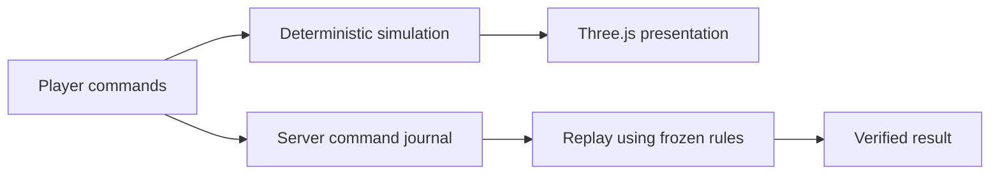

# Browser game and faction systems

The current game is [demo/index.html](demo/index.html); [index.html](index.html)
is its entry page. The older `v2/`, `server-demo/` and design comparison pages
retain development history. Some `v2/` world data is still used by frozen rules;
do not delete it on the assumption that every old-looking path is unused.

## Change the right layer

| Task | Files to read first |
| --- | --- |
| Orders, economy or combat | [demo/engine.js](demo/engine.js), [demo/operation.js](demo/operation.js) |
| Faction units and abilities | [demo/faction-rules.js](demo/faction-rules.js) |
| Buildings and research choices | [demo/building-catalog.js](demo/building-catalog.js), [demo/faction-tech.js](demo/faction-tech.js) |
| Enemy decisions and counters | [demo/enemy-ai.js](demo/enemy-ai.js) |
| Tutorial lessons and first-minute guidance | [demo/tutorial.js](demo/tutorial.js), [demo/opening-guide.js](demo/opening-guide.js) |
| Unit animation and world rendering | [servers/live-world.js](servers/live-world.js), [servers/faction-assets.js](servers/faction-assets.js) |
| Building geometry and effects | [servers/research-buildings.js](servers/research-buildings.js), [servers/visual-effects.js](servers/visual-effects.js) |
| Entry-to-account faction intent | [entry-flow.js](entry-flow.js), [entry/entry.js](entry/entry.js) |
| Ranked browser recording | [demo/ranked-client.js](demo/ranked-client.js), [demo/ranked-protocol.js](demo/ranked-protocol.js) |

## Simulation and presentation

Rendering may interpolate animation between simulation steps. Presentation
changes must not change command acceptance, combat outcomes or replay timing.
Rules changes require an explicit compatibility/season plan; changing a hash
alone does not make existing verified matches compatible.

Misanthropic emphasizes containment and resilience, Closed AI coordination and
linked formations, and Broke Labs burst pressure and heat management. Preserve
those differences when changing silhouettes, movement or tactical feedback.

## Run and review

`npm start` verifies the included art and serves the full game locally.
`npm run dev:server` skips the fingerprint preflight; incomplete checkouts show
the contributor workspace while account/standings development remains available.
See [asset scope and license](../docs/ASSETS.md).

Use [the test map](../tests/README.md) for the affected layer. Full-art browser
startup is `HI_BROWSER_GAME=1 npm run test:browser`, in background Chromium.
Check the entry, tutorial and game at 100% zoom. Keep textures, geometry,
shadows, reflections and animation intact; report frame pacing separately from
simulation checks. A startup test does not establish 60 FPS or enjoyable play.

## First Light milestones and recovery

First Light v3 keeps the existing maps, renderer and controls. Its 18 milestones
cover the original 17 goals: **Defend → Sustain → Breach**. The formation goal is
split into `formation.open` and `formation.finish`; it counts once, after both.
Use `tutorialPhase(game)` and `tutorialProgress(game)` for progress. The numeric
`tutorial.step` is always the named compatibility sentinel `3`, because the
frozen engine uses lower values for an old resource clamp. Never use it as a
lesson index or change ranked rules to accommodate the tutorial.

`LocalArchive` owns one whole-state checkpoint outside the game state. The
controller prepares it before releasing an encounter, before paid campus work,
and before the rival breach. Retry restores a validated temporary copy while
paused; it never grants resources on an ordinary chapter transition. An earlier
viable point remains intact when preparing another fails. Storage denial permits
session-only play with a warning. A native Web Lock gives only one tab permission
to write tutorial saves. Browsers without that primitive stay session-only.

The v3 tutorial slot is separate from the original operation/legacy save slot.
Migration preserves paid state and the exact legacy bytes; independently changed
saves get an explicit chooser. Later old saves skip the added opening without
claiming they witnessed its tactic. The original reader cannot overwrite v3.
See the complete synthetic [paid-state migration example](../tests/fixtures/first-light/migration-example.json)
and [fixture provenance](../tests/fixtures/first-light/README.md).

Run `node tests/tutorial.mjs` for the action/migration matrix and
`node tests/first-light-client.mjs` for transport and debrief race checks.
The [diagnostic catalogue](../docs/LOCAL_DEVELOPMENT.md#first-light-diagnostics)
explains recovery and safe error reporting. Nothing here changes verified score
calculation or makes tutorial results eligible for the leaderboard.
