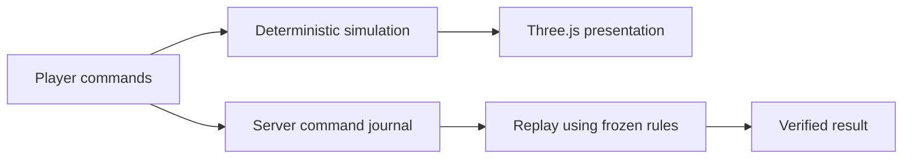

# Browser game and faction systems

The current game is [demo/index.html](demo/index.html); [index.html](index.html)
is its entry page. The older `v2/`, `server-demo/` and design comparison pages
retain development history. Some `v2/` world data is still used by frozen rules;
do not delete it on the assumption that every old-looking path is unused.

## Change the right layer

| Task | Files to read first |
| --- | --- |
| Orders, economy or combat | [demo/engine.js](demo/engine.js), [demo/operation.js](demo/operation.js) |
| Faction units and abilities | [demo/faction-rules.js](demo/faction-rules.js) |
| Buildings and research choices | [demo/building-catalog.js](demo/building-catalog.js), [demo/faction-tech.js](demo/faction-tech.js) |
| Enemy decisions and counters | [demo/enemy-ai.js](demo/enemy-ai.js) |
| Tutorial lessons and first-minute guidance | [demo/tutorial.js](demo/tutorial.js), [demo/opening-guide.js](demo/opening-guide.js) |
| Unit animation and world rendering | [servers/live-world.js](servers/live-world.js), [servers/faction-assets.js](servers/faction-assets.js) |
| Building geometry and effects | [servers/research-buildings.js](servers/research-buildings.js), [servers/visual-effects.js](servers/visual-effects.js) |
| Entry-to-account faction intent | [entry-flow.js](entry-flow.js), [entry/entry.js](entry/entry.js) |
| Ranked browser recording | [demo/ranked-client.js](demo/ranked-client.js), [demo/ranked-protocol.js](demo/ranked-protocol.js) |

## Simulation and presentation

Rendering may interpolate animation between simulation steps. Presentation
changes must not change command acceptance, combat outcomes or replay timing.
Rules changes require an explicit compatibility/season plan; changing a hash
alone does not make existing verified matches compatible.

Misanthropic emphasizes containment and resilience, Closed AI coordination and
linked formations, and Broke Labs burst pressure and heat management. Preserve
those differences when changing silhouettes, movement or tactical feedback.

## Run and review

`npm start` verifies the included art and serves the full game locally.
`npm run dev:server` skips the fingerprint preflight; incomplete checkouts show
the contributor workspace while account/standings development remains available.
See [asset scope and license](../docs/ASSETS.md).

Use [the test map](../tests/README.md) for the affected layer. Full-art browser
startup is `HI_BROWSER_GAME=1 npm run test:browser`, in background Chromium.
Check the entry, tutorial and game at 100% zoom. Keep textures, geometry,
shadows, reflections and animation intact; report frame pacing separately from
simulation checks. A startup test does not establish 60 FPS or enjoyable play.
